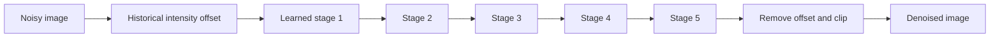

# Deep Patch-Beltrami


**Unrolled geometric image denoising from the original trained models.**

Deep Patch-Beltrami turns the differential operators of patch-space Beltrami
flow into learned convolution kernels and unrolls the update into a five-stage
network. This repository provides PyTorch inference with the original learned
parameters and a complete reproduction of the BSD68 results in Aaron Wetzler's
2017 PhD thesis, *Topics in Computational Geometric Vision*, Chapter 4 §4.5.


## iPhone app

Run the original five-stage denoiser locally with **Core ML**, full-resolution
photo import and a draggable before/after view. On the tested iPhone 12,
256×256 grayscale takes **536 ms** (median of three warm filter runs).
The fast mixed mode uses
validated accelerator paths; accurate FP32 remains selectable. All eight
noise-specific checkpoints are included in the model download. Grayscale and
RGB images can have odd, non-square or larger-than-tile dimensions.

```bash
# macOS, Xcode 16.1+; download, verify and compile all eight model sets.
python3 ios/scripts/fetch_models.py
open ios/DeepBeltramiApp.xcodeproj
```

In Xcode choose your Apple signing team and an **iOS 18+** iPhone, then Run.
No PyTorch installation is needed to build the app from released Core ML
models. The download is about **182 MiB**. To compile from the command line:

```bash
TEAM_ID=YOUR_TEAM_ID ios/scripts/build_ios.sh
```

[Installation, precision modes and measured performance](ios/README.md) ·
[Numerical and hardware evidence](ios/VALIDATION.md)

The demo above was processed on a physical iPhone 12. Instruments verifies
actual GPU and Neural Engine execution for the released fast 256-pixel model.
Larger images use exact context halos, and RGB processes three channels;
large-photo filtering takes longer. Accurate Core ML also reproduces all
**544 BSD68 cases / eight printed thesis means** in the native Mac check.

## Quick start

Python 3.10 or newer; Linux is the validated environment. A CPU is sufficient.
PyTorch uses CUDA automatically when available.

```bash
git clone https://github.com/twerdster/deep-patch-beltrami.git
cd deep-patch-beltrami
python3 -m venv .venv
source .venv/bin/activate
python -m pip install -e .

# A procedural example with Gaussian noise; downloads the original models.
python examples/demo.py

# Denoise a grayscale or RGB image. Sigma is on the 0–255 intensity scale.
deep-patch-beltrami denoise noisy.png denoised.png --sigma 25
```

The demo saves numerical arrays, PNG previews and PSNR under `results/demo/`.
It generates its own clean image; no benchmark photograph is bundled.
At sigma 25, its verified CPU result improves PSNR from **20.15 to 39.32 dB**.

## Reproduce the thesis results

```bash
deep-patch-beltrami reproduce bsd68 --output results/bsd68.json
```

One command downloads and verifies the original checkpoints, a noise-only
fixture and 68 separately hosted clean BSD68 PNGs. It reconstructs all **544
original noisy inputs** exactly, verifies their hashes, runs inference and
checks all eight means in **thesis Table 4.6** at the printed precision.
The model/noise downloads total about **400 MiB**, plus the clean images.

| Noise σ | Thesis PSNR (dB) | Reproduced PSNR (dB) |
| ---: | ---: | ---: |
| 5 | 37.70 | 37.695809 |
| 10 | 33.52 | 33.522676 |
| 15 | 31.37 | 31.365600 |
| 20 | 29.92 | 29.918060 |
| 25 | 28.87 | 28.865240 |
| 30 | 28.04 | 28.038062 |
| 40 | 26.81 | 26.811863 |
| 50 | 25.95 | 25.947914 |

Every prediction is finite. Metrics use full-image, floating-point PSNR after
clipping predictions to [0,255], without rounding, border cropping or test-time
augmentation. A full run exits unsuccessfully if a quoted mean fails to match.
The [per-image verification record](docs/results/bsd68.json) includes the input
hashes, 544 scores and differences from the original Caffe outputs.

```bash
# A quick smoke test, explicitly reported as a partial suite.
deep-patch-beltrami reproduce bsd68 --sigmas 25 --limit 2 --device cpu \
  --output results/smoke.json

# Full execution without a GPU.
deep-patch-beltrami reproduce bsd68 --device cpu --output results/bsd68-cpu.json

# Download and verify inputs without running inference.
deep-patch-beltrami prepare-bsd68
```

The cache defaults to `~/.cache/deep-patch-beltrami/v1`. Use `--cache-dir PATH`
to select storage. [The reproduction guide](docs/reproduction.md) covers
offline assets, custom images, user-supplied portrait data and detailed checks.
`python -m deep_patch_beltrami` provides the same interface as the command.

## Model

Each noise level has a separate original model with five stages, 80 feature
channels and 7×7 filters. The port executes the original deployment graphs
directly, including shared weights within each stage. MATLAB and Caffe are
not required. The release provides pretrained inference; it does not repeat
the original training.



The saved files are **40,000-step checkpoints**, although the thesis describes
100,000 steps. The original grayscale wrapper also uses sigma-specific
intensity offsets whose selection procedure was not recovered. Both details
are preserved and disclosed for faithful reproduction. The historical network
uses W,H spatial axes; public image commands handle the transpose automatically.

The model archive contains inference-only Caffe-format files. Non-inference
metadata was removed, and every learned tensor was verified byte-for-byte
against the original checkpoint. Numerical differences between PyTorch and
Caffe are small; matching printed scores does not imply identical output
pixels. See [reproducibility details](docs/REPRODUCIBILITY.md).

## Tests

```bash
python -m pip install -e '.[test]'
python -m pytest
```

Unit tests use synthetic arrays and need no model downloads. The full BSD68
command separately verifies the released tensors and original experiment
inputs. Models and noise residuals are attached to [release
v1.0.0](https://github.com/twerdster/deep-patch-beltrami/releases/tag/v1.0.0).

## Citation

Please cite the thesis for Deep Patch-Beltrami:

```bibtex
@phdthesis{wetzler2017topics,
  author = {Wetzler, Aaron},
  title = {Topics in Computational Geometric Vision},
  school = {Technion -- Israel Institute of Technology},
  year = {2017},
  note = {Chapter 4, Section 4.5: Operator tuning: a deep perspective}
}
```

The deep method is documented in the thesis; no separate peer-reviewed Deep
Patch-Beltrami publication is identified here. The underlying classical method
is described in Wetzler and Kimmel, *Efficient Beltrami Flow in Patch-Space*,
SSVM 2011 (Springer proceedings published 2012),
[doi:10.1007/978-3-642-24785-9_12](https://doi.org/10.1007/978-3-642-24785-9_12).
Its runnable implementation is in
[beltrami-denoising](https://github.com/twerdster/beltrami-denoising).
[references.bib](references.bib) includes thesis, background and dataset citations.

## License and data

The code is [MIT licensed](LICENSE). The author's trained parameters and
deployment graphs include their MIT license inside the model archive.
Benchmark images are downloaded separately and retain their dataset terms;
private portraits are not distributed. The noise fixture contains Gaussian
residuals, with no clean or noisy photographs. See
[attribution and external materials](THIRD_PARTY_NOTICES.md).
