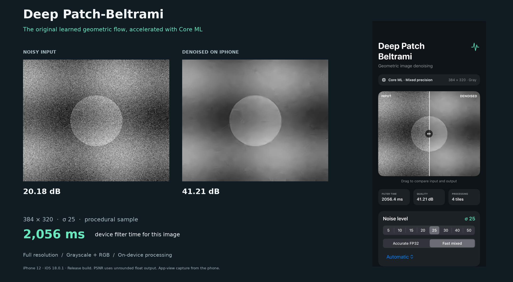
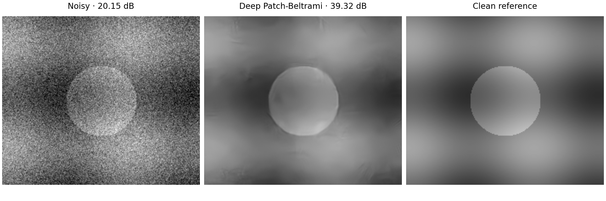
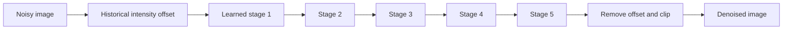

# Deep Patch-Beltrami

[](pyproject.toml)
[](ios/README.md)
[](LICENSE)



This package reads grayscale or RGB images and filters them with the original
Deep Patch-Beltrami checkpoints using PyTorch. RGB is processed as three
independent grayscale channels. It also reconstructs the 544
archived noisy BSD68 inputs and checks the eight mean PSNR values in Aaron
Wetzler's 2017 thesis, *Topics in Computational Geometric Vision*, Chapter 4
§4.5. A separate SwiftUI app runs converted models through Core ML on iOS.
The software provides inference and experiment reproduction; it does not
repeat the historical training.



The second figure is Python demo output; the first contains the phone app capture.


## iPhone app

The app runs the five-stage denoiser through **Core ML**, with full-resolution
photo import and a draggable input/output view. The
[iPhone 12 record](ios/benchmarks/iphone12.json) reports **536 ms** for
256×256 grayscale at sigma 25 in mixed/Automatic mode (median of three warm
filter runs, Release build, iOS 18.0.1). That case actually ran
`DeepBeltrami_sigma25_mixed16_masked256`, without FP32 fallback. Model loading,
photo import and display are excluded; this is
not a sustained-throughput estimate. Accurate FP32 remains selectable. All eight
noise-specific checkpoints are included in the model download. Grayscale and
RGB images can have odd, non-square or larger-than-tile dimensions; see the
[recorded geometry cases](ios/benchmarks/iphone12.json).

```bash
# macOS, Xcode 16.1+; download, verify and compile all eight model sets.
python3 ios/scripts/fetch_models.py
open ios/DeepBeltramiApp.xcodeproj
```

In Xcode choose your Apple signing team and an **iOS 18+** iPhone, then Run.
No PyTorch installation is needed to build the app from released Core ML
models. The download is about **182 MiB**. To compile from the command line:

```bash
TEAM_ID=YOUR_TEAM_ID ios/scripts/build_ios.sh
```

[Installation, precision modes and measured performance](ios/README.md) ·
[Numerical and hardware evidence](ios/VALIDATION.md)

The first figure shows a procedural sample processed on a physical iPhone 12; its
PSNR uses a known clean reference. The
[runtime trace summary](ios/benchmarks/hybrid-runtime.json) records GPU and
app-correlated ANE evaluation calls overlapping Neural Engine activity for the
sigma-25 mixed masked256 model in Automatic mode. The trace does not attribute
every layer or establish placement for other models/settings. Larger images
use context halos; RGB images run three channel passes.

The [native Mac record](ios/benchmarks/bsd68-coreml-mac.json) checked all 544
BSD68 inputs using accurate FP32/Core ML with CPU+GPU on arm64 macOS 15.1.1.
Its eight mean PSNR values round to the thesis values. This is separate from
the phone's procedural checks and does not transfer that result to mixed mode.

## Quick start

Python 3.10 or newer; Linux is the validated environment. A CPU is sufficient.
PyTorch uses CUDA automatically when available.

```bash
git clone https://github.com/twerdster/deep-patch-beltrami.git
cd deep-patch-beltrami
python3 -m venv .venv
source .venv/bin/activate
python -m pip install -e .

# A procedural example with Gaussian noise; downloads the original models.
python examples/demo.py

# Denoise a grayscale or RGB image. Sigma is on the 0–255 intensity scale.
deep-patch-beltrami denoise noisy.png denoised.png --sigma 25
```

The demo saves numerical arrays, PNG previews and PSNR under `results/demo/`.
It generates a 192×224 clean image and adds Gaussian noise with seed 2017;
the displayed score describes that example, rather than a BSD68 mean. No
benchmark photograph is bundled.

## Reproduce the thesis results

```bash
deep-patch-beltrami reproduce bsd68 --output results/bsd68.json
```

One command downloads and verifies the original checkpoints, a noise-only
fixture and 68 separately hosted clean BSD68 PNGs. It reconstructs all **544
original noisy inputs** exactly, verifies their hashes, runs inference and
checks all eight means in **thesis Table 4.6** at the printed precision.
The model/noise downloads total about **400 MiB**, plus the clean images.

The values below come from the saved PyTorch/CUDA run. Other backends can
differ beyond the printed thesis precision and must run their own checks.

| Noise σ | Thesis PSNR (dB) | PyTorch/CUDA PSNR (dB) |
| ---: | ---: | ---: |
| 5 | 37.70 | 37.695809 |
| 10 | 33.52 | 33.522676 |
| 15 | 31.37 | 31.365600 |
| 20 | 29.92 | 29.918060 |
| 25 | 28.87 | 28.865240 |
| 30 | 28.04 | 28.038062 |
| 40 | 26.81 | 26.811863 |
| 50 | 25.95 | 25.947914 |

Every prediction is finite. Metrics use full-image, floating-point PSNR after
clipping predictions to [0,255], without rounding, border cropping or test-time
augmentation. A full run exits unsuccessfully if a quoted mean fails to match.
The [per-image verification record](docs/results/bsd68.json) includes the input
hashes, 544 scores and differences from the original Caffe outputs.

```bash
# A quick smoke test, explicitly reported as a partial suite.
deep-patch-beltrami reproduce bsd68 --sigmas 25 --limit 2 --device cpu \
  --output results/smoke.json

# Full execution without a GPU.
deep-patch-beltrami reproduce bsd68 --device cpu --output results/bsd68-cpu.json

# Download and verify inputs without running inference.
deep-patch-beltrami prepare-bsd68
```

The cache defaults to `~/.cache/deep-patch-beltrami/v1`. Use `--cache-dir PATH`
to select storage. [The reproduction guide](docs/reproduction.md) covers
offline assets, custom images, user-supplied portrait data and detailed checks.
`python -m deep_patch_beltrami` provides the same interface as the command.

## Model

Each noise level has a separate original model with five stages, 80 feature
channels and 7×7 filters. The port executes the original deployment graphs
directly, including shared weights within each stage. MATLAB and Caffe are
not required. The release provides pretrained inference; it does not repeat
the original training.

Within each stage, learned derivative filters feed metric terms, inverse-metric
weighting, fluxes, learned divergence filters and a flow update. The
[PyTorch graph executor](src/deep_patch_beltrami/inference.py) implements the
saved graphs' `Padding`, `Convolution`, `Power` and `Eltwise` layers. It is
specific to these deployment graphs, rather than a general Caffe runtime.

Schematic of the inference sequence; it does not depict processor placement or timing:



The saved files are **40,000-step checkpoints**, although the thesis describes
100,000 steps. The original grayscale wrapper also uses sigma-specific
intensity offsets whose selection procedure was not recovered. Both details
are preserved and disclosed for faithful reproduction. The historical network
uses W,H spatial axes; public image commands handle the transpose automatically.

The model archive contains inference-only Caffe-format files. Non-inference
metadata was removed, and every learned tensor was verified byte-for-byte
against the original checkpoint. The saved BSD68 record has a maximum absolute
per-case PSNR difference of 0.0000373 dB from archived Caffe outputs; matching
printed scores does not imply identical output pixels.
See [reproducibility details](docs/REPRODUCIBILITY.md).

## Tests

```bash
python -m pip install -e '.[test]'
python -m pytest
```

Unit tests use synthetic arrays and need no model downloads. The full BSD68
command separately verifies the released tensors and original experiment
inputs. Models and noise residuals are attached to [release
v1.0.0](https://github.com/twerdster/deep-patch-beltrami/releases/tag/v1.0.0)
(the model/noise assets are unchanged in package 1.1.0).
The recorded eight synthetic tests cover parsing, selected graph operators,
axis/offset conventions, clipping and download integrity. They do not
establish general graph correctness or numerical fidelity on every backend.

## Limitations

RGB processing applies the grayscale model independently to each channel.
Historical grayscale offset calibration was not recovered. Phone timings
depend on geometry, precision and tile count; small mixed-mode requests can
fall back to FP32. A masked512 parity failure on A14 excludes that variant
from ANE-permitted modes, as documented in the [iOS guide](ios/README.md).
The public BSD68 result does not validate the unavailable portrait dataset or
new training runs.

## Citation

Please cite the thesis for Deep Patch-Beltrami:

```bibtex
@phdthesis{wetzler2017topics,
  author = {Wetzler, Aaron},
  title = {Topics in Computational Geometric Vision},
  school = {Technion -- Israel Institute of Technology},
  year = {2017},
  note = {Chapter 4, Section 4.5: Operator tuning: a deep perspective}
}
```

The deep method is documented in the thesis; no separate peer-reviewed Deep
Patch-Beltrami publication is identified here. The underlying classical method
is described in Wetzler and Kimmel, *Efficient Beltrami Flow in Patch-Space*,
SSVM 2011 (Springer proceedings published 2012),
[doi:10.1007/978-3-642-24785-9_12](https://doi.org/10.1007/978-3-642-24785-9_12).
Its runnable implementation is in
[beltrami-denoising](https://github.com/twerdster/beltrami-denoising).
[references.bib](references.bib) includes thesis, background and dataset citations.

## License and data

The code is [MIT licensed](LICENSE). The author's trained parameters and
deployment graphs include their MIT license inside the model archive.
Benchmark images are downloaded separately and retain their dataset terms;
private portraits are not distributed. The noise fixture contains Gaussian
residuals, with no clean or noisy photographs. See
[attribution and external materials](THIRD_PARTY_NOTICES.md).
