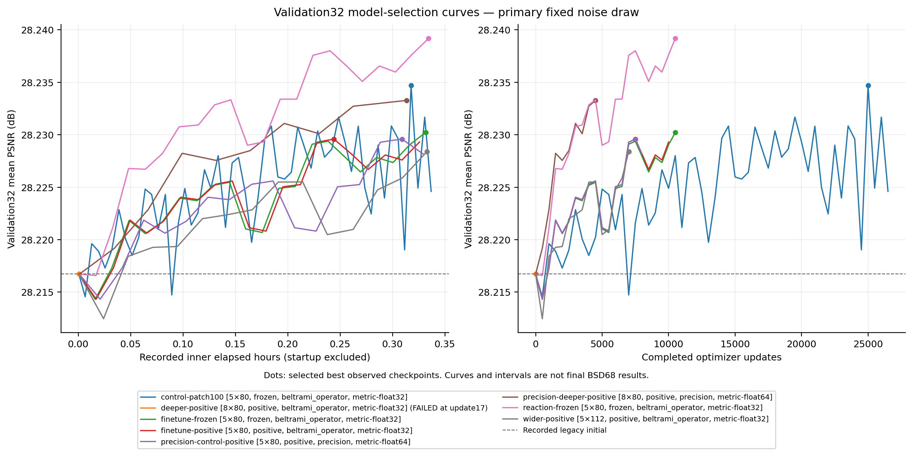

# Learned Beltrami operator experiments

This optional package trains the differential operators inside the unrolled
Beltrami flow. It preserves the learned derivatives, local metric, flux,
divergence and explicit update described in the thesis. The original inference
package, released checkpoints and iOS app remain independently reproducible.

## Held-out results at σ = 25

A small fidelity reaction improves the five-stage operator by **+0.010271 dB**
over its matched continued-training control on the 68 archived BSD68 inputs
(66 improved images, 2 worse). The conditional paired-image 95% interval is
[+0.008306, +0.012338] dB. Both models select update 52,000 using the independent
32-image validation set. Relative to the original checkpoint, reaction gains
+0.042975 dB; most of that total gain also appears with continued training alone.

| Frozen model | Stages × channels | Parameters | New updates | PSNR (dB) | Forward (ms) |
| --- | ---: | ---: | ---: | ---: | ---: |
| Historical checkpoint | 5 × 80 | 3,195,600 | — | 28.865240 | 63.904 |
| Continued frozen-metric control | 5 × 80 | 3,195,600 | 52,000 | 28.897944 | 58.891 |
| Fidelity reaction | 5 × 80 | 3,195,605 | 52,000 | 28.908215 | 58.964 |
| Precision five-stage control | 5 × 80 | 3,195,600 | 25,000 | 28.891054 | 87.685 |
| Precision eight-stage operator | 8 × 80 | 5,112,960 | 14,500 | 28.894934 | 139.432 |

The deeper precision operator has a small, outlier-sensitive mean advantage of
+0.003881 dB over its precision control, but loses on 36/68 images and has a
negative median change (−0.000959 dB). This does not establish a robust depth
benefit. Its compute allowance permits fewer updates than the control.

PSNR is the mean of full-image floating-point image scores. Forward time is the
median across image medians on an RTX 4090 with PyTorch 2.7.1, two warmups and
three synchronized repeats; it excludes transfers, clipping and scoring.
Intervals condition on one training seed, frozen checkpoints and one noise draw.
They exclude training-seed, noise-draw and selection uncertainty.

[Full results and limitations](docs/RESULTS.md) ·
[All six frozen contrasts](docs/results/operator-sigma25/REPORT.md) ·
[Per-image scores](docs/results/operator-sigma25/per-image.csv) ·
[Earlier modern-model comparison](docs/MODERN_CONTEXT.md)

All five models and six comparisons were frozen before this round's BSD68
scoring. A separate tensor-only replay matched all 340 input/label identities,
MSE and PSNR scores, clipping counts and six paired summaries exactly; see the
[reproduction check](docs/released-weight-reproduction.json). Complete aggregate
charged process wall time was **6.891 hours of the 12-hour ceiling**, including
startup, failures and both evaluations; this is not GPU busy time.

The new weights are for the optional Python research package. The existing iOS
app continues to use the original five-stage models.

## Install

Python 3.10+, PyTorch 2.5+, Linux or macOS. Training and budget tools require
POSIX file locking. CUDA is optional; high-precision metric arithmetic uses
float64 and is supported on CPU/CUDA, rather than MPS.

```bash
# From the repository root, inside your virtual environment:
python -m pip install -e . -e ./research
cd research
```

A separate research wheel contains the three research namespaces; the parent
inference package supplies the original Caffe tensor reader. For development,
install `'.[test]'` and `'./research[test,datasets,plots]'` from the repository
root. The optional `datasets` dependencies reconstruct validation images;
`plots` adds Matplotlib. Neither is needed for released-model inference.

## Run the released models

Download the four `dpb-*.pt` files from [release v1.2.0](https://github.com/twerdster/deep-patch-beltrami/releases/tag/v1.2.0)
into a local `weights/` directory. With the optional GitHub CLI:

```bash
# Run from research/ after installing both packages above.
gh release download v1.2.0 --repo twerdster/deep-patch-beltrami \
  --pattern 'dpb-*.pt' --dir weights

beltrami-operator-denoise noisy.png denoised.png \
  --checkpoint weights/dpb-reaction-sigma25-step52000.pt --device cpu
```

The four inference-only assets total about 56 MiB. The
[model manifest](docs/results/operator-sigma25/models.json) pins each file,
its tensors, numerical source and training provenance. Its SHA256 is:

```text
20a3ea6011dfde4facf8bbf94aad5ad71aff3bed006328a56c14e8ed2e83c40b
```

To reproduce every frozen model and comparison on CPU, prepare the unchanged
public image/noise/model inputs, then run the released-weight evaluator. No
training crops or raw training checkpoints are required. Each output directory
must be new.

```bash
CACHE="$PWD/benchmark-cache"
deep-patch-beltrami prepare-bsd68 --cache-dir "$CACHE"
python tools/evaluate_released.py \
  --manifest docs/results/operator-sigma25/models.json \
  --manifest-sha256 20a3ea6011dfde4facf8bbf94aad5ad71aff3bed006328a56c14e8ed2e83c40b \
  --weights-dir weights --model-dir "$CACHE/models" \
  --asset-dir "$CACHE/downloads" --clean-dir "$CACHE/bsd68-clean" \
  --cache-dir "$CACHE" --gpu-lock "$PWD/gpu.lock" \
  --device cpu --threads 4 --output evaluations/released-bsd68-cpu-001
```

The full CPU run can take substantially longer than CUDA. See
[released-weight evaluation](docs/RELEASED_EVALUATION.md) for a bounded GPU
reproduction and comparison against the pinned numerical reference. Saved
image previews are 8-bit; the evaluator scores floating-point predictions.

## Operators and controls

| Experiment | Stages × channels | Parameters | Matched control |
| --- | ---: | ---: | --- |
| Continued original operator | 5 × 80 | 3,195,600 | Historical checkpoint |
| Positive trainable metric | 5 × 80 | 3,195,600 | Continued frozen metric |
| Wider positive metric | 5 × 112 | 6,230,000 | Positive 5 × 80 |
| Deeper positive metric | 8 × 80 | 5,112,960 | Positive 5 × 80 with the same arithmetic |
| Fidelity reaction | 5 × 80 | 3,195,605 | Continued frozen metric |

Each stage uses learned 7×7 derivatives, shared depthwise 7×7 metric smoothing,
the metric determinant/inverse and flux, two learned dense 7×7 divergence
operators and a 1×1 projection. Width and depth start from an embedding of the
original function. Positive metrics use a softplus parameterization of shared
weights and diagonal biases. Reaction adds `lambda * (noisy - current)` with
lambda initialized to zero and projected to [0,1]; its five stored scalars have
four effective degrees of freedom because the first-stage difference is zero.

Two frozen numerical implementations are explicit:

- `beltrami_operator` retains the original float32 arithmetic. A deeper pilot
  exposed float32 cancellation in the Gram determinant and was rejected for
  non-finite output. Failure is retained as a research result.
- `beltrami_precision` performs metric convolution, determinant and flux in
  float64, with float32 parameters and dense convolutions. It introduces no
  determinant epsilon or clamp. Depth must be compared against the matching
  five-stage precision control. It is not bit-identical to float32 arithmetic.

`docs/source-hashes.json` pins every numerical source byte and each namespace's
aggregate hash. Inference/export support lives in a third namespace so it can
evolve without changing the identity of a trained numerical implementation.
Positive metrics imply positive definiteness mathematically, but do not prove
global stability of the learned update; finite-output/gradient gates remain
required. The original derivative filters are not constrained to zero DC.

## Screening and failures

The eight pilot records include seven clean budget stops and one failed
float32-depth run. Wider positive metrics did not improve their matched control
in validation. The smaller-patch control receives more updates and checkpoint
opportunities within its time allowance, so its selected-best advantage does
not isolate patch size. Reaction and precision depth were continued alongside
their matching controls; no additional training followed the fixed four-run
continuation plan.

[Completed pilot matrix and limitations](docs/validation-screening.md) ·
[Continuation review](docs/validation-continuations.md) ·
[Exact screening aggregates](docs/validation-screening.json)



The figure reports validation screening, not held-out test results. Failed
float32 depth is excluded from valid trained-model accuracy comparisons;
its preserved numerical failure motivated the separate precision cohort.

## Data

See [data provenance and permissions](docs/DATA.md) before obtaining images.
No dataset photographs are included in this repository or model assets.

The frozen training manifest identifies 400 author-recovered 180×180 grayscale
crops. Exact continuation of these experiments requires those matching PNGs
under `data/original400/`. They are not automatically reconstructed from BSDS500:
small historical grayscale rounding differences prevent a byte-exact recipe.

The 32 source-disjoint validation images can be prepared from pinned upstream
JPEGs. The command verifies both decoded pixels and encoded PNG hashes, and
preserves conflicting existing files:

```bash
python tools/prepare_validation32.py
```

To train on other separately obtained grayscale PNGs, create new manifests:

```bash
python tools/make_manifest.py --root /path/to/training-images \
  --output data/custom-train.json --split train --prior-checkpoint-exposure unknown
python tools/make_manifest.py --root /path/to/validation-images \
  --output data/custom-validation.json --split validation --prior-checkpoint-exposure unknown
```

Supply those manifests and roots explicitly to the trainer. This is a new data
protocol, rather than exact repetition of the recorded experiment. Exclude the
same source photographs across splits, not just identical decoded files;
the runtime duplicate hash check cannot establish crop/source independence.

## Bounded training

Configs record sigma 25, offset +25, Adam 1e-5, fresh noise and rotation/flip
augmentation, batch 2, gradient clipping at 1 and 60,000-step ceilings.
Most use 160×160 crops; the separate 100×100 control isolates patch-size effects.
An eight-stage operator has a 145-pixel receptive field, versus 91 for five
stages, so crop size affects boundary exposure.

The following is a 0.35-hour pilot within a user-chosen **aggregate** 2-hour
allowance. All process wall time, startup, evaluation and failures are charged.
Choose your own allowance before launch; ledger creation is exclusive and
never resets prior accounting.

```bash
MODEL_DIR="$(python -c 'from deep_patch_beltrami.assets import models; print(models())')"
python tools/create_budget.py --hours 2
python tools/lease_runner.py --budget-file BUDGET.json \
  --run-id pilot-control-001 --hours 0.35 --log runs/pilot-control-001/console.log -- \
  python -m beltrami_operator.train \
    --config configs/pilot-finetune-frozen.json \
    --data-root data/original400 --manifest data/train400.json \
    --validation-root data/validation32 --validation-manifest data/validation32.json \
    --model-dir "$MODEL_DIR" --output runs/pilot-control-001 \
    --gpu-lock "$PWD/gpu.lock" --max-gpu-hours 0.34 --device cuda:0
```

Use `--device cpu` for CPU checks. Use `python -m beltrami_precision.train` and
its `configs/pilot-precision-*.json` for the high-precision cohort. Run one
worker at a time with the same GPU lock and aggregate ledger. The tools cap
their own allocation at 10 GiB by default and reject low disk space. They do
not reserve GPU memory against other applications. Supervise actual progress,
checkpoints, finite loss/gradients, device health and free space; use recurring
checks for unattended jobs. A bounded systemd user service with
`KillMode=control-group` can provide an independent process-group deadline.

Runs save `metadata.json`, `status.json`, JSONL events, full-image validation
records and atomic `last.pt`/`best.pt` checkpoints. Metadata includes local paths
and host details for private reproducibility; do not publish raw run folders.
A clean budget stop is `stopped` with reason `budget`, not completion of the
step ceiling. A successful outer lease does not imply completed training.

## Resume and select

Resume `last.pt` with the exact same configuration, manifests and numerical
source. It restores optimizer, sampler and Torch RNG state. Extend the
cumulative inner `--max-gpu-hours` allowance; a new outer lease charges only
the new wall time. Do not resume an earlier best checkpoint and replay its
sampler trajectory.

`tools/promote_run.py` prepares a new output, freezes the parent's last
checkpoint, carries the prior best forward, checks finite optimizer/model
state and source/config/data identity, and retains a 0.5-hour evaluation
reserve plus the ledger's 60-second global margin. Its expected layout uses
`data/train400.json`, `data/validation32.json` and the corresponding image roots.
For custom data, use `tools/resume_training.py --implementation
beltrami_operator --` followed by the explicit trainer arguments, including
`--resume`. This preflight checks source/config/manifest/original-model
identity, strict tensor keys and finite model/optimizer state before invoking
the frozen trainer. The raw trainer's `--resume` only checks configuration and
manifests; use the guarded helper for supported continuation.

```bash
# Write a substantive validation-only reason in promotion-decision.txt first.
python tools/promote_run.py --parent runs/pilot-control-001 \
  --output runs/continued-control-001 --config configs/pilot-finetune-frozen.json \
  --hours 0.5 --decision promotion-decision.txt --model-dir "$MODEL_DIR" \
  --gpu-lock "$PWD/gpu.lock" --launch

python tools/summarize_sweep.py --root . --run-glob 'pilot-*' --output reports/pilots
```

For several already prepared continuations, use the
[sequential queue](tools/PROMOTION_QUEUE.md), which validates the complete plan
and remaining allowance before executing its saved commands. It never prepares
a run or retries a failed one implicitly. Its terminal checks verify actual
training progress and fresh last/best checkpoints before starting the next entry.

The [reporting guide](tools/SUMMARIZING.md) covers copied snapshots and promoted
runs. Promotion reports verify ancestry, retain inherited best/step0 records and
separate cumulative from continuation exposure and charged time. Use a scoped
run glob so only the intended promoted controls participate. For snapshots
copied from a different project location, pass `--recorded-root` explicitly;
the public default is this checkout, with strict containment and no basename
fallback. Live continuation trends are provisional until the planned run ends.

Compare equal arithmetic/metric cohorts and report steps, images seen and wall
time, rather than implying equal training exposure from equal time budgets.
The new fresh noise/augmentation also differs from the recovered historical
generator's fixed 1,600 corner crops and fixed noise draw.

## Final evaluation and model export

[Freeze selection before evaluation](docs/EVALUATION.md). Select architecture,
checkpoint and stopping rule on validation only. BSD68 uses the unchanged public
loader's original noise inputs, native N,C,W,H interface, fixed archived offset,
finite prediction gate, final float clipping and full-image float64 PSNR.
Report paired image differences and uncertainty against the matched continued
control as well as the historical checkpoint. Do not tune on the final scores.

The completed frozen evaluation publishes [sanitized evidence and tables](docs/results/operator-sigma25/REPORT.md).
The [publication workflow](docs/PUBLICATION.md) checks selected checkpoint and
export tensor identity before producing the release manifest. All four exports
preserve every learned tensor and omit optimizer/RNG state and private paths.
The public reader loads them with `weights_only=True`. Public reproduction uses
the [tensor-only evaluator](docs/RELEASED_EVALUATION.md), without author training
images or raw training checkpoints.

For publication, build a draft manifest before the public replay, then refresh
the report with its completed compute ledger. The pinned
`reference-results.json` excludes accounting, so it and `models.json` must stay
byte-identical between draft and final builds; `results.json` records all costs.

For your own training runs, export a trusted local checkpoint for inference
without optimizer/RNG/private metadata:

```bash
python tools/export_model.py --trusted-checkpoint runs/continued-control-001/best.pt \
  --config configs/pilot-finetune-frozen.json --implementation beltrami_operator \
  --output operator-sigma25.pt
beltrami-operator-denoise noisy.png denoised.png --checkpoint operator-sigma25.pt
```

The public reader uses `torch.load(weights_only=True)`, strict tensor keys,
finite checks, a tensor-content digest and exact numerical-source identity.
The export command reads trusted local training serialization; only that
conversion step uses full PyTorch checkpoint loading. Inference accepts odd,
non-square grayscale/RGB images without resizing. RGB applies the grayscale
operator independently to each channel with zero intensity offset, matching the
historical RGB wrapper. Whole-image inference uses memory proportional to image
area; no mobile speed claim or new iOS conversion follows from these experiments.
The existing iOS app uses the original five-stage models and 45-pixel halo.

## Citation and license

Code and author parameters are MIT licensed under the repository's
[license](../LICENSE). Images retain separate dataset terms. Cite Aaron
Wetzler, *Topics in Computational Geometric Vision*, Technion PhD thesis, 2017,
Chapter 4 §4.5; the repository's [citation](../CITATION.cff) and
[BibTeX](../references.bib) provide the full record.
