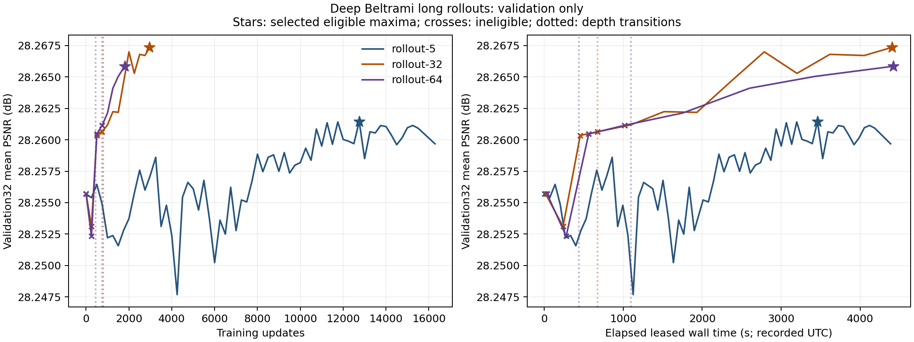

# Deep Beltrami: Geometric Diffusion as a Learnt Operator

This study tests 32- and 64-stage, untied rollouts of the learned
discrete Beltrami-inspired operator. It retains learned spatial derivatives,
metric smoothing, determinant/inverse, flux, divergence, projection and an
explicit fidelity reaction. The title describes the architecture; it does not
assert a convergence theorem or grid-independent neural-operator theory.

The previous [v1.2.0 results](RESULTS.md) are complete and unchanged. All three
training arms have finished and the joint selection was frozen before new
benchmark scoring. All three tensor-only exports passed exact CPU
tensor/raw/safe/adapter checks, and all four models completed BSD68 scoring.
A separate tensor-only replay reproduced all 272 metric records and six
paired summaries exactly. The existing iOS app continues to use its original
five-stage models.

## Reused BSD68 benchmark at σ = 25

The 32-stage operator scores **28.922632 dB**, a small **+0.007363 dB** over
the new five-stage control, with 52 improved images and 16 worse. Its median
image change is +0.002374 dB. The 64-stage operator is slightly worse than 32
stages on average and loses on 58/68 images, while taking about twice as long.
This round does not establish that increasing depth monotonically improves
quality or that the longer operator is a practical speed/quality improvement.
The new five-stage control itself improves by +0.007054 dB over released
reaction; the 32-stage total +0.014417 dB includes that shared protocol change
and continued training. It cannot all be attributed to additional stages.

| Frozen model | Stages | Parameters | Selected update | PSNR (dB) | Median forward (ms) |
| --- | ---: | ---: | ---: | ---: | ---: |
| New protocol control | 5 | 3,195,605 | 12,750 | 28.915269 | 87.071 |
| Long rollout | 32 | 20,451,872 | 2,959 | 28.922632 | 557.607 |
| Long rollout | 64 | 40,903,744 | 1,803 | 28.920873 | 1,110.835 |
| Released v1.2.0 reaction | 5 | 3,195,605 | 52,000 in prior study | 28.908215 | 59.333 |

| Fixed comparison | Mean ΔdB | Conditional 95% interval (dB) | Improved / worse images |
| --- | ---: | --- | ---: |
| 32 − new 5 | +0.007363 | [+0.003968, +0.011675] | 52 / 16 |
| 64 − new 5 | +0.005604 | [+0.002271, +0.009852] | 40 / 28 |
| 64 − 32 | −0.001759 | [−0.002279, −0.001246] | 10 / 58 |
| New 5 − released reaction | +0.007054 | [+0.005224, +0.009070] | 56 / 12 |
| 32 − released reaction | +0.014417 | [+0.009744, +0.020301] | 61 / 7 |
| 64 − released reaction | +0.012658 | [+0.008042, +0.018500] | 57 / 11 |

BSD68 was already observed in v1.2.0: these are **reused-benchmark results**,
not newly untouched held-out evidence. All four models and six comparisons
were fixed before new scoring; no benchmark score changed selection or the
stopping rule. Intervals use 20,000 paired-image percentile bootstrap resamples,
seed 20261113. They condition on selected checkpoints, one training seed and
one fixed noise realization, excluding training/noise-seed, selection and prior
benchmark-exposure uncertainty. They are unadjusted across the six comparisons.

PSNR averages the full-image floating-point scores after output-only clipping
to [0,255], using float64 MSE with peak 255. Inputs are the identical archived,
unclipped float32 observations, native N,C,W,H, fixed +25; there is no border
crop, input rounding or test-time augmentation. Nonfinite outputs fail before
clipping. Whole-image forward timing is the median of per-image medians on a
shared RTX 4090, PyTorch 2.7.1/CUDA 12.6, two warmups and three synchronized
repeats. It excludes transfers, clipping and scoring. The 32/64-stage times are
about **6.4×/12.8×** the new five-stage control; these are not phone timings.
The two largest image gains account for 32.03%/39.85% of the net 32−5/64−5
mean improvement. The corresponding median changes are +0.002374/+0.000833 dB.

The [earlier released-model comparison](MODERN_CONTEXT.md) measured modern
references at 29.490154–29.560451 dB on these archived inputs. Those models
were not rerun in this study; their training data and compute are unmatched.
The record supplies context, not an exhaustive current frontier or an
architectural comparison with equal training resources.

The separately leased public safe-weight replay reproduced all **272**
input/label hashes, native shapes, MSE, PSNR and clipping records and all six
paired summaries exactly. See the [reproduction receipt](rollout-released-weight-reproduction.json).
This does not establish prediction pixel-array or timing identity. Final
accounting preserves the tested manifest, stable reference and all three
scientific CSV files byte-for-byte. Across both research rounds, aggregate
charged process wall time was **38,860.536379 seconds / 10.794593 hours of
the original 12-hour ceiling**, including startup, historical failures and
final evaluation/replay. This is conservative process wall time, not GPU busy
time. All training and evaluation leases are finished; no extra training was
performed to consume unused allowance.

[All fixed results](results/rollout-sigma25/REPORT.md) ·
[Per-image scores](results/rollout-sigma25/per-image.csv) ·
[Runtime records](results/rollout-sigma25/runtime.csv) ·
[Earlier modern-model context](MODERN_CONTEXT.md)

## Completed training and validation selection



These are validation-selection curves, not benchmark results. All saved model
and optimizer states and logged losses/gradients were finite. Independent CPU
review rechecked the file, decoded-pixel and shape hashes for all 400 training
and 32 validation images. Selection was frozen jointly before new scoring.

| Arm | Terminal / selected updates | Full-depth updates at terminal | Eligible validations | Selected validation PSNR (dB) | Charged training seconds |
| --- | ---: | ---: | ---: | ---: | ---: |
| Five-stage control | 16,286 / 12,750 | 16,286 | 63 | 28.261454 | 4,384.322 |
| 32 stages | 2,959 / 2,959 | 2,209 | 9 | 28.267359 | 4,401.128 |
| 64 stages | 1,803 / 1,803 | 1,002 | 4 | 28.265857 | 4,421.256 |

The 32-stage arm performed 750 updates at depth 16, then 2,209 at depth 32.
The 64-stage arm performed 444 at depth 16, 357 at depth 32 and 1,002 at depth
64. Each optimizer update uses two sampled noisy crops. The five-stage run
therefore sampled 32,572 crops, versus 5,918 and 3,606 for the deeper arms;
these are repeated/augmented samples, not unique images. All runs stopped at
the fixed resource limit without extensions. An eligible checkpoint required
at least 20 full-target-depth updates; partial curricula and initialization
were excluded, and exact score ties selected the earliest update.

The selected 32-stage checkpoint leads the five-stage control by 0.005906 dB
on validation32, with 21 wins/11 losses; the top two changes account for 70.71%
of the net gain. The 64-stage validation gain is 0.004403 dB with 17 wins/15
losses and a conditional interval including zero; two images account for
93.23% of its net gain. It loses to 32 stages on 28/32 validation images.
These are small, selection-conditioned validation findings. See the complete
[validation review](validation-rollouts.md) and [machine-readable curves](validation-rollouts.json).

## Fixed comparison

| Arm | Stages × channels | Parameters | Maximum charged training time |
| --- | ---: | ---: | ---: |
| New protocol control | 5 × 80 | 3,195,605 | 1.25 hours |
| Long rollout | 32 × 80 | 20,451,872 | 1.25 hours |
| Long rollout | 64 × 80 | 40,903,744 | 1.25 hours |

All arms start from the released reaction checkpoint at update 52,000,
SHA256 `9a085c0745136eaee86bfaf0b2e1eb31926eb3bb0526169134fa3a89cf2cfed5`.
The prefix uses positive, trainable metric parameters with float64 metric/flux
arithmetic and float32 parameters/dense convolutions. This arithmetic differs
from the released reaction implementation, which requires a new five-stage
control. Initializing the positive parameters also introduces rounding changes.

Additional stages copy the fifth stage's internal filters and zero both the
projection and reaction. They initially act as identities with live projection
and reaction gradients. All parameters are untied. The first five updates retain
their original scale; extra-stage updates use the fixed scale `1 / (T - 5)`.
Thus increasing stage count does not simply multiply the initial flow horizon.

The configurations in `configs/rollout-{5,32,64}-001.json` fix:

- AdamW with prefix learning rate 1e-5 and refinement learning rate 5e-5;
  weight decay 1e-4 on dense kernels and no decay on metric/reaction parameters.
- Five percent learning-rate warmup and one cosine decay to 10% of peak.
- A 16→32 curriculum for 32 stages and 16→32→64 for 64 stages, based on elapsed
  fractions of the inner wall allowance, including startup and validation.
- Intermediate supervision with weight 0.05, annealed to zero by 30% of the
  inner allowance. The five-stage control has no intermediate auxiliary target.
- Recovered 180px crops, fresh sigma-25 noise, +25 offset, rotation/reflection
  augmentation, microbatch one with accumulation two and gradient clipping at 1.
- Non-reentrant activation checkpointing in blocks of four stages, retaining
  full backpropagation. No AMP, TF32, determinant clamp or training-output clip.

These are comparisons of complete architecture/training protocols. Curriculum,
auxiliary supervision and refinement learning rates prevent interpreting the
result as an isolated causal effect of depth. Equal time also gives different
update counts and checkpoint-selection opportunities; report both exposure and
quality. A single warmup followed by cosine decay is used, without repeated
high-learning-rate restarts or an optimizer sweep.

## Run with separately supplied data

Install both packages using the [research installation instructions](../README.md#install).
Download the pinned reaction weight from [v1.2.0](https://github.com/twerdster/deep-patch-beltrami/releases/tag/v1.2.0).
Exact training needs the recovered author crops, which are not distributed;
see [data provenance](DATA.md). Other training images define a different study.

The following runs one arm using an **existing** aggregate ledger. Create a
ledger only for genuinely new accounting with an explicitly chosen allowance;
never replace an existing ledger to reset spent time. Leave final-evaluation
time and a shutdown margin in the remaining aggregate allowance before launch.

```bash
# Run from research/ after installation; supply the pinned data and weight.
python tools/lease_runner.py --budget-file BUDGET.json \
  --run-id rollout-32-001 --hours 1.25 --log runs/rollout-32-001/console.log -- \
  beltrami-rollout-train \
    --config configs/rollout-32-001.json \
    --data-root data/original400 --manifest data/train400.json \
    --validation-root data/validation32 --validation-manifest data/validation32.json \
    --warmstart weights/dpb-reaction-sigma25-step52000.pt \
    --output runs/rollout-32-001 --gpu-lock "$PWD/gpu.lock" \
    --max-gpu-hours 1.2166666666666666 --device cuda:0
```

Use a new output and lease identifier for each arm. The inner allowance above
leaves 120 seconds within the outer lease for final full-depth validation and
checkpoint writing. Measure the worst-case validation/save time on the actual
machine before relying on that margin. Run an actual full-depth forward/backward
preflight before unattended training. The trainer caps its own CUDA allocation
at 10 GiB but does not reserve memory against other applications.

The equivalent module command is `python -m beltrami_rollout.train`. Help and
synthetic CPU checks do not need training data or a GPU:

```bash
beltrami-rollout-train --help
CUDA_VISIBLE_DEVICES= python -m pytest tests/test_rollout_model.py tests/test_rollout_training.py
```

The author-weight CPU integration is optional: set `BELTRAMI_REACTION_SAFE` to
the pinned local reaction asset to exercise the actual 64-stage initialization
and finite-gradient check. It does not score a benchmark.

## Selection, monitoring and limits

Use the independent validation32 set only. A checkpoint becomes eligible after
at least 20 optimizer updates at the full target depth; initialization and
partial-curriculum identity suffixes are ineligible. Select the highest eligible
validation score, keeping the earliest exact tie. Record phase/full-depth
updates, actual sampled exposure, source/config/data identities, every evaluated
snapshot and charged process wall time. The configured 100,000-update ceiling
does not mean that a bounded run reaches it or converges.

Source bytes for all three numerical namespaces are pinned in
[rollout-source-hashes.json](rollout-source-hashes.json). Keep these files frozen
while the corresponding runs/checkpoints are active. The separate
`tools/export_rollout.py` and `beltrami-rollout-denoise` support the new
tensor-only format. Existing v1.2.0 export and evaluation commands retain their
original implementation guards; use the dedicated long-rollout tools.

Supervise process/service identity, advancing steps and timestamps, logs,
checkpoints, complete validation, finite losses/gradients/model/optimizer,
GPU utilization/memory/temperature, kernel errors and disk. Keep a recurring
monitor active for unattended jobs, normally every two hours, through failures
and recovery. Preserve evidence, diagnose and validate recovery before a new
lease; do not blindly relaunch an existing queue or interfere with other work.

Nominal spatial radii are 288/576 pixels at 32/64 stages, exceeding the 180px
training crops. No training pixel has its full nominal unpadded context. Effective
influence can be more local with small refinements, but boundary-dominated
training remains a material limitation. Positive metrics do not prove global
stability of free learned divergence/projection updates.

Freeze architecture, stopping rule, checkpoint, source, configuration, data and
evaluator identities before final scoring. BSD68 was already observed in the
previous study, so any new result is a **reused benchmark**, not a newly untouched
holdout. Do not use it to tune this round. Compare the frozen long operators to
the new five-stage control and released reaction using identical archived inputs,
paired image statistics and measured runtime; retain one-seed/noise/selection
limitations and weak or negative findings. Verify safe-weight replay before
marking reproduction complete, and finish publication checks before release.

## Download and run the selected weights

Install repository package **1.3.0** and research package **0.2.0** using the
[research instructions](../README.md#install). CPU and CUDA are supported;
float64 metric/flux arithmetic is required, so MPS is not supported. The new
weights are sigma-25 models. They are separate from the historical command and
the iOS app. No new 32/64-stage mobile performance has been established.

The three new tensor-only files total about 246 MiB. Download them from
[release v1.3.0](https://github.com/twerdster/deep-patch-beltrami/releases/tag/v1.3.0);
the prior reaction file remains at its unchanged v1.2.0 URL.

```bash
# Run from research/ after installing both packages.
gh release download v1.3.0 --repo twerdster/deep-patch-beltrami \
  --pattern 'dpb-rollout-*.pt' --dir weights
gh release download v1.2.0 --repo twerdster/deep-patch-beltrami \
  --pattern 'dpb-reaction-sigma25-step52000.pt' --dir weights

beltrami-rollout-denoise noisy.png denoised.png \
  --checkpoint weights/dpb-rollout-32-sigma25-step2959.pt \
  --expected-sha256 88a6801b0dc157e51f8929cb6e018e3878e7407849a15247a90f5c0bf4547f52 \
  --device cpu
```

Use `--device cuda:0` for CUDA inference. The five-stage file is
`dpb-rollout-5-sigma25-step12750.pt`; the 64-stage file is
`dpb-rollout-64-sigma25-step1803.pt`. The
[model manifest](results/rollout-sigma25/models.json) pins each filename,
whole-file and tensor SHA256, source/configuration, selected checkpoint and
training exposure. Its independent SHA256 is:

```text
93813fe42da42a749bcbf10e6c4e2cc1fef7dbea119171401f6553e83d236bba
```

The [full reproduction guide](ROLLOUT_REPRODUCTION.md) explains the bounded
Linux CUDA replay of all **272** image/model cases and six fixed comparisons.
That replay needs only safe weights and unchanged public inputs, with no raw
training checkpoints or training crops. Its [completed verification](rollout-released-weight-reproduction.json)
records exact score/input identity. A CPU image-inference example or export
identity check is not the benchmark replay.

For a separately trained model, `python tools/export_rollout.py --help`
describes the trusted-local exporter. Raw checkpoints require an explicit
trusted SHA and must never be distributed: only sanitized tensor-only outputs
are inference assets.

The inference reader uses `weights_only=True`, checks the frozen numerical
sources and validates the model configuration, metadata and tensor digest.
With a separately exported asset at `weights/selected-rollout.pt`:

```bash
beltrami-rollout-denoise noisy.png denoised.png \
  --checkpoint weights/selected-rollout.pt --device cpu
```

Pass `--expected-sha256` with an independently recorded asset SHA to check the
whole file before loading. CUDA is also supported. Output is a new, lossless
8-bit PNG; an existing output is not overwritten. The array adapter preserves
unclipped float32 input and clips only finite final predictions. RGB uses three
independent grayscale observations with the fixed +25 offset for **each**
channel. This differs from the historical image CLI's RGB offset policy, which
is unchanged. RGB execution establishes channel handling, not a color-denoising
benchmark result. PNG display output rounds floats; benchmark scoring uses the
unrounded output.

The file command converts image files to 8-bit grayscale/RGB; HDR, 16-bit and
floating-point file ranges are not retained. The array adapter accepts
unclipped float32 observations. Convenience image inference is separate from
the strictly configured, leased benchmark replay described in
[reproduction](ROLLOUT_REPRODUCTION.md).

All three selected author exports preserve every learned tensor byte. CPU
raw/safe/adapter predictions match exactly on a fixed, hash-verified validation
crop, singleton rows/columns and derived RGB. See the five-stage
[export](rollout-5-export-verification.json) and [crop](rollout-5-crop-verification.json),
32-stage [export](rollout-32-export-verification.json) and [crop](rollout-32-crop-verification.json),
and 64-stage [export](rollout-64-export-verification.json) and [crop](rollout-64-crop-verification.json)
receipts. These establish export identity, not denoising quality. Synthetic
CPU tests separately cover safe loading and odd, narrow and RGB arrays. Full
safe-weight benchmark reproduction is recorded independently in the
[replay receipt](rollout-released-weight-reproduction.json).

Cite Aaron Wetzler's 2017 thesis, Chapter 4 §4.5, using the repository
[citation](../../CITATION.cff). Code and author parameters use the repository
[MIT license](../../LICENSE); image rights remain separate.

## Related work and terminology

The recovered image operator and its attribution come from the 2017 thesis.
[Trainable Nonlinear Reaction Diffusion](https://arxiv.org/abs/1508.02848)
is closely related unrolled image-restoration work with stagewise and joint
training. [AdamW](https://arxiv.org/abs/1711.05101) separates weight decay from
adaptive gradient updates; it does not establish stability of a learned flow.
[ReZero](https://www.auai.org/uai2021/pdf/uai2021.519.pdf) is related identity
residual initialization; these refinements instead initialize their final
projection and reaction to zero with a nonzero fixed update scale.

[Beltrami Flow and Neural Diffusion on Graphs](https://proceedings.neurips.cc/paper_files/paper/2021/hash/0cbed40c0d920b94126eaf5e707be1f5-Abstract.html)
is relevant later geometric neural-diffusion work on graphs. Here “learned
operator” means a finite-step discrete image operator. Arbitrary image sizes
alone do not establish the function-space or grid-refinement properties studied
in [Neural Operator](https://arxiv.org/abs/2108.08481).
