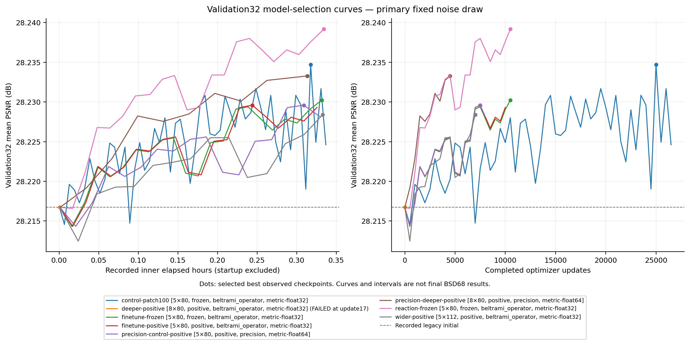

# Validation-only operator screening

These completed pilots compare learned Beltrami operator variants at sigma 25. **They are validation32 model-selection results, not final BSD68 results.** Seven arms stopped cleanly at their time allowances; float32 depth failed and was excluded. Continuation and final benchmark results are separate.

The left panel uses recorded inner elapsed time, excluding startup; the table below uses actual charged lease time including startup and evaluation. The right panel shows unequal completed updates. Dots mark the highest observed primary-validation means. The failed float32 depth point is initialization only and supplies no trained-model score.

## Trial matrix

| Trial | Stages × channels / metric arithmetic | Params | Patch | Completed updates | Lease seconds | Evaluations¹ | Best step | Primary mean dB | Matched control / best delta dB |
|---|---|---:|---:|---:|---:|---:|---:|---:|---|
| Patch100 frozen control | 5 × 80 / float32 | 3,195,600 | 100 | 26,750 | 1225.765 | 54 | 25000 | 28.234705 | finetune-frozen / +0.004491 |
| Depth8, float32 (failed) | 8 × 80 / float32 | 5,112,960 | 160 | 17 | 8.002 | 1 | excluded | unavailable | unavailable (failed) |
| Frozen160 control | 5 × 80 / float32 | 3,195,600 | 160 | 10,785 | 1225.761 | 22 | 10500 | 28.230214 | self; — |
| Positive160 metric | 5 × 80 / float32 | 3,195,600 | 160 | 10,443 | 1225.968 | 21 | 7500 | 28.229594 | finetune-frozen / -0.000620 |
| Precision5 control | 5 × 80 / float64 | 3,195,600 | 160 | 8,278 | 1225.932 | 17 | 7500 | 28.229594 | self; — |
| Precision8 depth | 8 × 80 / float64 | 5,112,960 | 160 | 4,896 | 1226.027 | 10 | 4500 | 28.233278 | precision-control-positive / +0.003684 |
| Fidelity reaction | 5 × 80 / float32 | 3,195,605 | 160 | 10,690 | 1225.799 | 22 | 10500 | 28.239174 | finetune-frozen / +0.008960 |
| Width112 positive | 5 × 112 / float32 | 6,230,000 | 160 | 7,159 | 1226.075 | 15 | 7000 | 28.228398 | finetune-positive / -0.001196 |

¹ Includes initialization. Self-control rows have no independent architecture contrast; their zero self-deltas are explicitly identified in JSON. The failed depth arm completed 17 updates before the non-finite prediction gate, with no valid post-training accuracy evaluation.

All arms use sigma 25, fixed intensity offset +25, batch 2, Adam at 1e-5 with no weight decay, gradient clipping at 1, training seed 20261112 and primary validation-noise seed 742913. Most use 160×160 patches; the separate patch100 arm uses 100×100. Noise is fresh unclipped Gaussian noise with random crops and D4 rotations/reflections. Training minimizes raw MSE/255². Full-image evaluation uses prediction-only float clipping, float64 MSE and mean per-image PSNR, with no crop, resize or test-time augmentation.

The float32 cohort uses `beltrami_operator`; the float64 metric/flux cohort uses `beltrami_precision` while retaining float32 dense operations. The exact namespace, metric trainability and configuration for each row are in the JSON record.

This continuation recipe differs from the recovered historical generator: 1,600 fixed four-corner 100×100 crops and one fixed noise draw. Improvements over the historical checkpoint therefore include further training and new sampling. The matching continued-training controls isolate the additional operator changes more closely.

## Matched evidence and negative results

- **Reaction:** five stored scalars, four effective coefficients, add a small explicit fidelity term. The selected primary pilot leads frozen160 by +0.008960 dB and improves 31/32 images. At the common 10,500 updates, this is the same contrast. The effect is small and consistent across the two fixed noise draws.
- **Depth:** precision8 versus precision5 is +0.003684 dB at independently selected best checkpoints, with a conditional image-bootstrap interval crossing zero. At the common 4,500 updates it is +0.007681 dB. Two images explain much of the selected-best mean; exploratory depth evidence does not establish general equal-compute superiority. Float32 depth failed from Gram determinant cancellation; the separate float64 metric/flux cohort has its own matched precision control.
- **Width:** 112 channels increases parameters to 6.23 million and remains below the positive80 control: −0.001196 dB at selected best and −0.000893 dB at the common 7,000 updates. This is a bounded negative result.
- **Patch size:** patch100 selected best is +0.004491 dB versus frozen160 but uses 25,000 versus 10,500 updates and 54 versus 22 evaluations. At common 10,500 updates it is −0.002210 dB. The time-allowance result confounds throughput, pixels and checkpoint selection.
- **Metric training:** positive versus frozen is only +0.000263 dB at common 10,000 updates, while independently selected best is −0.000620 dB. Endpoint choice matters at this scale.

## Second predeclared noise draw

Noise seed 1742913 was fixed before its scores. Every eligible checkpoint stayed selected on the primary draw; the failed arm was excluded. These are the same 32 photographs, not a second independent image dataset.

| Frozen pilot contrast | Mean delta dB | Improved images | Conditional paired image-bootstrap 95% interval |
|---|---:|---:|---|
| wider-positive vs finetune-positive | -0.001816 | 11/32 | [-0.004058, +0.000464] |
| reaction-frozen vs finetune-frozen | +0.009255 | 31/32 | [+0.006967, +0.011901] |
| precision-deeper-positive vs precision-control-positive | +0.003861 | 16/32 | [-0.001959, +0.010948] |

Reaction remains broadly positive; depth retains an outlier-sensitive positive mean and an interval including zero. Width remains negative. The complete small aggregate summary, including all frozen pilot means, is in [validation-screening.json](validation-screening.json).

The pre-score second-draw selection SHA256 is `6b331ea7524082778aec5d6e4cd0859f24cadf2cd3993a30396ababe1b689b07`. The source result SHA256 is `774e8e456f6d6c7bb15b77225ee046441897159beb9757a946fb6fcb7d5a2df5`. These identify the evidence without distributing private raw runs.

## Provenance and limits

The 400 recovered training crops map to all 200 official BSDS500 train and 200 test source photographs. Validation32 comprises the 32 official validation photographs outside the 68 BSD68 identities. Source-identity exclusion was audited, but historical development exposure and near-duplicate scenes cannot be ruled out. No dataset photographs are distributed; see [data provenance](DATA.md).

Training manifest SHA256: `f8a22e7177107990eff632eef8385a17e40398903bf2d6be0bc5a8cae448c8c0`. Validation manifest SHA256: `27736aa4658ffbd9f072c8990b9d370ae8734431b70818edf5a04fbe4d59780e`. Numerical namespace hashes are pinned in [source-hashes.json](source-hashes.json); per-trial config/source/selected-validation hashes are retained in the screening JSON.

Each primary best is selected from that trial’s observed checkpoints, earliest step on ties. Different trial speeds produce different numbers of updates, training pixels and opportunities to select a favorable checkpoint. Common-update endpoints still have unequal compute. Paired bootstrap intervals condition on selected checkpoints, one training seed and the fixed noise realization; they do not remove trial/checkpoint selection bias or estimate training-seed variation. Two noise draws do not make 64 independent photographs.

These pilot results motivated bounded matched continuations. They do not establish final test improvement, modern state of the art, perceptual benefit, a global stability theorem or new iOS performance. The original released models and original iOS applications remain separate reproduction targets.

The core operator follows Chapter 4 §4.5 of Aaron Wetzler's thesis; see the repository's [citation record](../../CITATION.cff).
